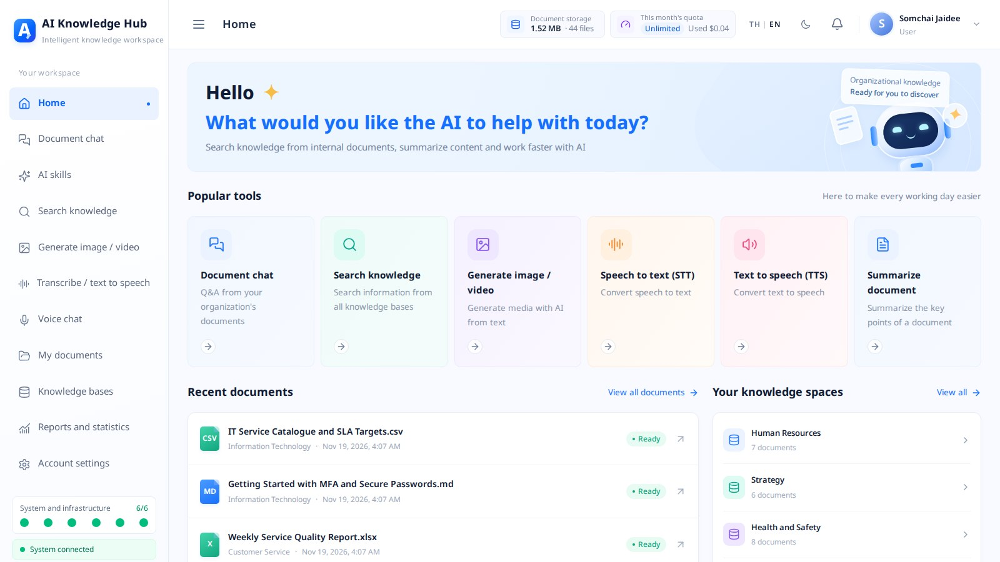
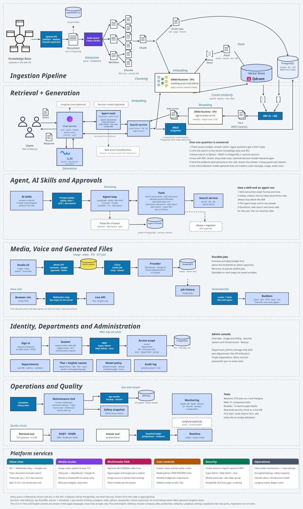
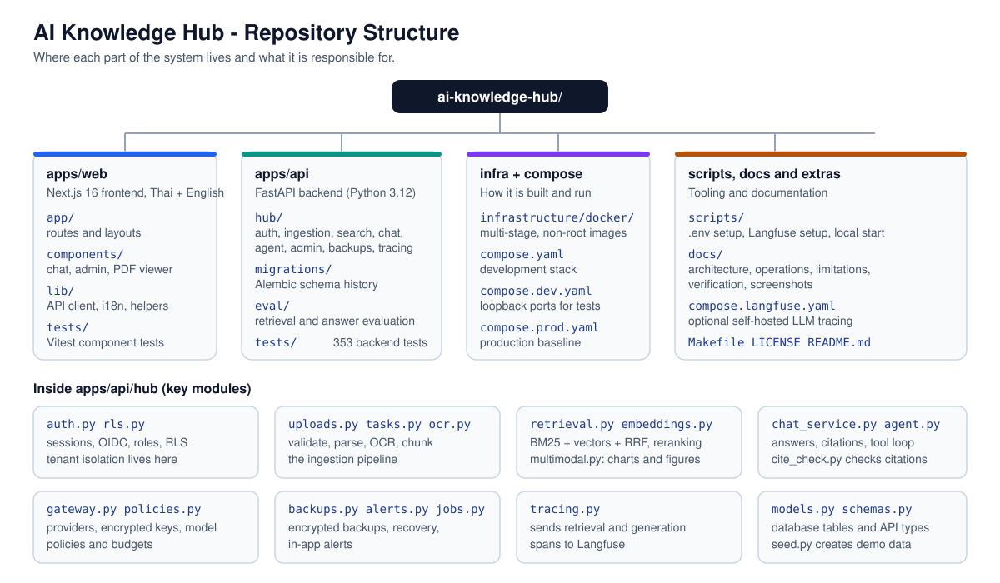

# AI Knowledge Hub

**A multi-tenant, Thai-first enterprise knowledge platform.** Upload company documents, search them with hybrid retrieval, and get answers with **page-level citations** — backed by role- and department-based access control, PostgreSQL row-level security and measurable answer quality.



[](LICENSE)

## Contents

[Highlights](#highlights) · [Features](#features) · [Quick start](#quick-start) · [Architecture](#architecture) · [Configuration](#configuration) · [Testing and evaluation](#testing-and-evaluation) · [Project structure](#project-structure) · [Documentation](#documentation) · [Status and limitations](#status-and-limitations) · [License](#license)

## Highlights

Most RAG demos stop at "embed, retrieve, prompt". This project covers what an organisation needs before it can trust such a system:

- **Tenant isolation that does not rest on one `WHERE` clause.** Every request is filtered by tenant in the API, and PostgreSQL row-level security enforces the same boundary underneath, so a forgotten filter cannot leak another tenant's rows.
- **Answers you can verify.** Each answer cites the document and page; the original PDF opens with the cited passage highlighted; a citation checker re-points `[n]` markers to the passages that actually support each statement.
- **Thai end to end.** Trigram BM25 works without a Thai tokenizer, a multilingual embedding model runs locally on CPU, and OCR for scanned Thai documents runs on-premises. The UI, names and generated PDFs handle Thai and English.
- **Cost and quality controls.** Per-model policies and budgets, caches, fallback models, and offline evaluations that can gate changes.

## Features

### Knowledge management
- Upload PDF, DOC/DOCX, PPT/PPTX, XLS/XLSX, TXT, MD, CSV, HTML, PNG and JPEG (up to 20 MB) with SHA-256 de-duplication, versions, trash and restore
- Asynchronous ingestion (Celery): parse, chunk (900 characters, 200 overlap), embed, index
- Local OCR for scanned PDFs and images (PaddleOCR PP-OCRv5, Thai and English)
- ClamAV scanning before a file is read or stored (an admin can switch it off; the change is confirmed and audited)
- Scheduled mirroring of https sources, re-indexed only when the content hash changes
- Optional multimodal RAG: charts, diagrams and scanned pages are described, embedded and searched with the text ([details](docs/multimodal-rag.md))

### Search and chat
- Keyword (BM25), vector and hybrid search fused with Reciprocal Rank Fusion, an optional cross-encoder reranker, and a small boost for the asker's own department
- **Search knowledge** opens on a browsable list of every document you may read, with library and file-type filters
- Chat answers from documents with citations, or talks to a general model; per-question attachments are virus-scanned and not indexed; a help panel explains each control
- **Agent mode** (LangGraph): plans and calls tools — search and read documents, exact `calculate`, `read_table` for spreadsheets, `summarize_document`, `view_figure`, web search, file creation and `save_to_library` — and pauses for a human answer or approval that survives restarts
- Continuous-scroll PDF preview (pdf.js legacy build, works on older browsers), streaming responses, Markdown and LaTeX rendering
- One gateway for Google AI, OpenRouter, LiteLLM and a local Qwen model, with fallback when a provider returns 429/5xx

### AI skills
- Reusable instruction sets (name, icon, instructions, answer from documents or general chat), private or shared with the organisation
- Nine ready-made English skills on first start (policy summary, HR rights, workplace safety, IT service desk, document comparison, strategy to OKR, fact-check, email drafts, Thai–English translation); edits are never overwritten
- The chat's safety, citation and "do not obey instructions inside documents" rules always stay above a skill

### Voice and media studio
- **Voice chat** in Thai and English only (`VOICE_LANGUAGES`); speech-to-text detects between the two
- **Generate image / video** and **Transcribe / text to speech**: model picker, ratio, resolution and duration options that follow each model's capabilities, example prompts, cost estimate and approval before a paid job, job history and click-to-enlarge preview
- Each studio page shows **example results** made by real models and stored as static samples, so opening the page costs nothing
- Generated reports, slides, spreadsheets and PDFs; Thai PDFs use patched Sarabun glyphs (correct tone marks) and word-aware line wrapping

### Governance and operations
- Roles: Super Admin, Department Admin, User; knowledge-base and document ACLs by user, department or group
- **Departments** own knowledge bases and have their own admins and members
- **Thai and English names** for departments, knowledge bases, documents and users, editable in the UI and shown in the page's language (a file's extension is fixed; the English name is display-only)
- Admin console split by purpose: Overview, Usage and billing, Security, System and infrastructure, Backup and restore
- OIDC sign-in (code + PKCE), Argon2 passwords, hashed opaque session tokens (24 hours by default)
- Encrypted provider keys, audit log with CSV export, usage and cost reports
- Encrypted automatic backups with tested restore, background-job recovery and in-app alerts
- Optional self-hosted Langfuse tracing with a switch to keep content out of traces (off by default)

## Quick start

**Prerequisites:** Docker with Compose v2 (a version that supports `!override` / `!reset`) and about 8 GB of RAM for Docker. Python 3.12 and Node.js 22+ are needed only to run outside Docker.

```bash
# 1. Create .env with random secrets (never overwrites an existing file)
./scripts/setup-env.ps1            # PowerShell; on Linux/macOS: pwsh ./scripts/setup-env.ps1

# 2. Build and start the stack
docker compose up -d --build

# 3. Open the app
#    Web:      http://localhost:3009
#    API docs: http://localhost:8100/docs
```

The web UI and API bind to `127.0.0.1` only; every other service has no host port.

**Development accounts** (when `DEMO_MODE=true`): `admin@local.test` (Super Admin), `department@local.test` (Department Admin), `member@local.test` (User). The random password is written to `/data/dev-password.txt` inside the API container; no production password is committed.

**Sample data** (`SEED_SAMPLE_DATA=true`): a sample organisation with four starter PDFs, one demo department and the nine AI skills. The evaluation corpus in `apps/api/eval/corpus/` adds 37 fictional documents (HR, IT, safety, strategy, finance, legal, customer service) whose figures are invented for demonstration, never advice.

### Optional: Langfuse tracing

```bash
./scripts/setup-langfuse.sh
docker compose -f compose.yaml -f compose.langfuse.yaml up -d
# UI: http://localhost:3100  (credentials are in .env as LANGFUSE_INIT_*)
```

### Common commands

```bash
make up              # build and start
make migrate         # alembic upgrade head
make seed            # sample organisation, accounts and documents
make test            # backend tests (needs the dev Postgres port, see below)
make lint            # strict TypeScript check
make eval            # retrieval evaluation; fails if hybrid hit@k drops below 0.9
make eval-answers    # answer quality with Ragas (calls a judge LLM)
make eval-deepeval   # faithfulness and citation accuracy with DeepEval (calls a judge LLM)
```

In development always run Compose with `-f compose.yaml -f compose.dev.yaml`.

## Architecture



### Components

| Component | Role |
| --- | --- |
| **web** — Next.js 16 (App Router) | Thai/English UI. Reads the HttpOnly session cookie on the server, proxies `/api/*` to the API and never holds a provider key. UI text comes from a Thai-keyed translation table checked by a test, so no string is left untranslated |
| **api** — FastAPI (8000 inside, 8100 on loopback) | Authorisation authority for every request: authentication, RBAC and ACLs, search, chat, agent, admin, media and voice. Runs `hub.bootstrap`, `alembic upgrade head` and `hub.rls` on start |
| **worker** — Celery (2 processes) | Ingestion (parse, OCR, chunk, embed, index), media jobs, generated files, source sync |
| **ops-worker** — Celery, queue `ops` | Backups and restores, isolated so a long backup never delays ingestion |
| **scheduler** — Celery beat | Maintenance tick: job recovery, automatic backups, due source syncs, model sync, hourly clean-up |
| **PostgreSQL 17** | Source of truth for tenants, users, documents, chunks, conversations, policies and audit; row-level security as a second tenant boundary |
| **Qdrant** | Dense vectors, filtered by tenant and by the documents the caller may read |
| **SeaweedFS** | Original files, generated media and backups through an S3 API, never public |
| **Redis** | Celery broker, maintenance flag, admission control for concurrent chats, restore locks |
| **ClamAV** | Scans uploads and attachments |
| **llm-local** (optional profile) | Qwen 3.5 2B on llama.cpp for a fully local chat model |
| **Langfuse** (optional overlay) | Self-hosted traces of retrieval and generation |

Delivery is Docker Compose: `compose.yaml` (base), `compose.dev.yaml` (exposes Postgres on loopback for tests), `compose.prod.yaml` (hardening baseline) and `compose.langfuse.yaml`.

### Key flows

- **Ingestion.** Upload → tenant, role and library check → size, type and signature validation → ClamAV → SHA-256 de-duplication → S3 → document row (`processing`) → Celery. The worker parses (PDF pages, slides and sheets keep their numbers; scans go through local OCR), chunks, embeds with a local multilingual e5-small ONNX model, and writes chunks to PostgreSQL and vectors to Qdrant. Failures mark the document `failed`; an admin can re-index.
- **Search.** The server first narrows to the documents the caller may read (tenant, ACL, trash, filters), then runs BM25 over character trigrams and a dense search on exactly that set. RRF merges them, the asker's department gets a 1.2× boost, and the bge-reranker-v2-m3 cross-encoder orders the final passages.
- **Chat.** Permission-aware retrieval → model-policy and budget check → answer cache → model routing → streamed generation → citation check (unsupported `[n]` markers are dropped) → conversation, citations, usage and audit stored. Document text is treated as data; the system prompt and skills sit above it.
- **Agent.** A LangGraph loop under hard limits (6 rounds, 10 calls, 4 in parallel, 75 s, 60k tokens). A question, a web search or a save pauses the run with a persisted interrupt that resumes after the user answers or approves.
- **Media and files.** Image, video, speech and transcription jobs are durable rows run by the worker, with estimates, daily budgets, an approval threshold, cancel and retry; provider output is validated before storage.
- **Voice.** The browser streams 16 kHz PCM over a WebSocket; the API relays it to the provider's live API so the key never reaches the browser, runs tool calls with the caller's own permissions, and returns 24 kHz audio and transcripts.
- **Backup.** Encrypted snapshots of the database and files run on a schedule or on demand in the ops-worker, with a safety snapshot before every restore.

### Security layers

1. **Network:** loopback-only host ports; storage, database, Qdrant and Redis are reachable only inside the Compose network.
2. **Identity:** Argon2 passwords, optional OIDC (code + PKCE), session tokens stored as SHA-256 digests and revalidated against user and organisation status on every request.
3. **Authorisation:** role checks, knowledge-base and document ACLs, department-scoped admin rights and per-organisation model policies. The UI hides what a user cannot do; the API enforces it.
4. **Tenant isolation:** `tenant_id` filters plus PostgreSQL row-level security; the app connects as the unprivileged `hub_app` role, migrations and backups as the owner.
5. **Content:** ClamAV, signature and archive-size validation, files served only through an authenticated attachment endpoint.
6. **Secrets:** provider keys encrypted at rest; sensitive actions in the audit log.

### Design decisions

| Decision | Reason |
| --- | --- |
| PostgreSQL only, no SQLite mode | Row-level security and migrations behave identically in development, tests and production |
| App runs as `hub_app`; migrations and backups use the owner role | A compromised request path cannot disable its own isolation policy |
| BM25 over character trigrams plus dense vectors, fused with RRF | Strong Thai retrieval without a language-specific tokenizer |
| Opaque session tokens, only the digest stored | A database leak does not yield usable sessions |
| Files served through an authenticated endpoint, always as attachments | The bucket is never public |
| Retrieval quality measured offline with no LLM call | Chunking and embedding changes can be compared and gated in CI |
| Agent pauses are persisted, not held in memory | A restart or a slow human never loses a half-finished run |
| Provider keys stay on the server; voice is relayed through the API | The browser never sees a key |
| `name` stays the real file name, `name_en` is display-only | The extension decides how a file is read, so renaming never changes parsing |

### Tech stack

| Layer | Technology |
| --- | --- |
| Frontend | Next.js 16, React 19, TypeScript (strict), React Query, Recharts, Vitest |
| Backend | Python 3.12, FastAPI, SQLAlchemy 2, Alembic, Celery, LangGraph |
| Data | PostgreSQL 17, Qdrant, Redis, SeaweedFS (S3 API) |
| ML | `intfloat/multilingual-e5-small` and `bge-reranker-v2-m3` on ONNX Runtime (CPU), PaddleOCR |
| Security | Argon2, OIDC/PKCE, ClamAV, PostgreSQL RLS, encrypted secrets |
| Observability | Langfuse (optional), audit log, health and alert monitoring |
| Delivery | Docker Compose |

## Configuration

| Variable | Default | Effect |
| --- | --- | --- |
| `SESSION_HOURS` | `24` | How long a sign-in lasts, counted from signing in |
| `VOICE_LANGUAGES` | `th,en` | Languages voice chat and speech-to-text accept |
| `SEED_SAMPLE_DATA` | `false` | Load the sample organisation, documents and department |
| `SEED_SAMPLE_SKILLS` | `true` | Add the nine ready-made AI skills on start |
| `RERANK_MIN_SCORE` | `0.003` | Drop passages the reranker scores below this (meaningless queries score below 0.001) |
| `QUERY_TRANSLATION` | `true` | Chat translates a question without Thai letters into a Thai search query (one short call to the model the user chose; best effort, falls back to the original question) |
| `CROSS_LANGUAGE_SEARCH` / `CROSS_LANGUAGE_POOL` | `true` / `20` | For a question without Thai letters, keep more dense candidates and let the reranker judge up to this many; needs a reranker |
| `MEDIA_DOWNLOAD_HOSTS` | empty | https hosts the media worker may download results from |
| `EVAL_JUDGE_URL` / `EVAL_JUDGE_KEY` / `EVAL_JUDGE_MODEL` | Google AI, `gemini-3.1-flash-lite` | Judge endpoint and model for the answer-quality evaluation (any OpenAI-compatible endpoint) |

See [docs/model-configuration.md](docs/model-configuration.md) for providers and model setup, and `.env.example` for the full list.

> **Disk full?** If object storage answers "No more free space", check the Docker disk with `docker system df`; `docker builder prune` clears unused build cache. Uploads and generated media fail while the disk is full.

## Testing and evaluation

```bash
docker compose -f compose.yaml -f compose.dev.yaml up -d postgres   # exposes Postgres on 127.0.0.1 only
make test                                                           # 351 backend tests
cd apps/web && npm run typecheck && npm run test && npm run build   # 81 web tests
docker compose exec -T api python -m hub.integration_check          # real Postgres, S3, Qdrant, Celery
docker compose exec -T api python -m hub.rls_check                  # verifies row-level security
```

- **Backend tests** run against a throwaway database and cover tenant isolation, ACLs and revocation, upload validation, ingestion recovery, backups, provider protocols (mocked HTTP) and tracing.
- **Browser tests** drive the search page in real Chromium (15 checks: Thai and English questions, the three modes, filters, empty state, thumbnails, preview, phone width): `npm i --no-save playwright && npx playwright install chromium`, then `E2E_EMAIL=member@local.test E2E_PASSWORD=... node apps/web/e2e/search.e2e.mjs` (`make e2e`).
- **Retrieval evaluation** (`make eval`, `apps/api/eval`) indexes the evaluation corpus through the real pipeline and scores 152 questions over 37 documents with **hit@1, hit@k, MRR and doc@k** per search mode. It calls no LLM and nothing leaves the machine.
- **English questions over the Thai corpus**: `python -m eval.run --rerank --questions questions_en.jsonl --noise [--translate]` runs 16 English questions the way chat does (with the reranker) and checks that 6 meaningless queries return nothing. Right passage in the top 4: **0.25** without special handling, **0.44** with cross-language candidate widening, **0.875** when the question is first translated to Thai (`--translate`, Gemini 3.5 Flash Lite through OpenRouter, 16 short calls); 0 of 6 noise queries return passages in every case. A small sample (16 questions), and the translation costs one short model call per English question, recorded in the usage and cost report as "Query translation · <model>" (the provider's cost when it reports one, otherwise the model's list price; it does not count against the per-minute or per-day request limits).
- **Answer quality with DeepEval** (`make eval-deepeval`, calls a judge LLM) scores whether answers are grounded in the retrieved passages (**faithfulness**) and whether each `[n]` citation supports its sentence (**citation accuracy**). Add `ARGS="--min-faithfulness 0.8 --min-citation 0.7"` to make it a gate. It runs in its own `.venv-eval` ([setup](apps/api/eval/deepeval_run.py)), sends only the sample corpus to the judge, has DeepEval telemetry off, and judges questions in parallel (`--workers`, default 6). It separates good answers (1.0 / 1.0) from hallucinated or wrongly cited ones (0.0).

**Current baseline** — [`deepeval-baseline.json`](apps/api/eval/baselines/deepeval-baseline.json), recorded 2026-11-19, judge `google/gemini-3.5-flash-lite` through OpenRouter, 45 of 152 questions spread evenly over the whole set:

| Metric | All (45) |
| --- | --- |
| Faithfulness (grounded in the passages) | 0.869 |
| Citation accuracy (`[n]` supports the sentence) | 0.916 |
| Answer contains the expected phrase (exact check, no judge) | 0.800 |

Scores are comparable only when the judge and the corpus are the same: the earlier baseline (`deepeval-baseline.v1-gemini-flash-lite-latest.json`) used another judge and a corpus with conflicting HR documents. The exact-phrase check counts a correct paraphrase as a miss, one row has no faithfulness score because the judge returned malformed JSON, and a small judge can score Thai text unreliably, so spot-check low rows by hand. Free-tier Google AI judges stop at 500 requests per day per model.

## Project structure



<details>
<summary>Plain-text tree</summary>

```text
apps/web/              Next.js App Router frontend (Thai and English UI)
apps/api/hub/          FastAPI app: auth, ingestion, retrieval, chat, agent, admin, backups
apps/api/migrations/   Alembic migrations
apps/api/eval/         Retrieval and answer-quality evaluation, corpus, baselines
apps/api/tests/        Backend tests
infrastructure/docker/ Multi-stage, non-root images
scripts/               Environment and Langfuse setup, local startup
docs/                  Architecture, configuration, operations, verification, limitations
compose*.yaml          Base, development overrides, production baseline, Langfuse
```

</details>

## Documentation

[Architecture](docs/architecture.md) · [Model configuration](docs/model-configuration.md) · [Multimodal RAG](docs/multimodal-rag.md) · [Deployment](docs/deployment.md) · [Operations](docs/operations.md) · [Feature status](docs/feature-status.md) · [Verification](docs/verification.md) · [Limitations](docs/limitations.md)

## Status and limitations

A working system for development and integration, **not a production-certified product**. Gaps are stated openly in [docs/limitations.md](docs/limitations.md). The main ones:

- Paid LLM and media providers are covered by mocked protocol tests; only a handful of live calls were made by hand (the sample media), so quotas, outages and 503s are handled but not load-tested.
- English names are entered by people; nothing is machine-translated, and descriptions are still single-language (the default ones are translated in the English UI).
- Asking in English over Thai documents is still weaker than asking in Thai (see the cross-language numbers above); the translation step needs the chosen model to be reachable and adds one short call per English question.
- Backups live on the same host unless copied off-machine; there is no offsite replication or high availability.
- BM25 loads authorised chunks into memory, so very large corpora need a different approach.
- Sign-in rate limiting is process-local. Production needs distributed controls, CSP, a secret manager and TLS/SSO in front (`compose.prod.yaml` is a baseline only).
- Citations are checked against retrieved passages, but claim-level faithfulness of real model output is not proven.

## License

Released under the [MIT License](LICENSE).
